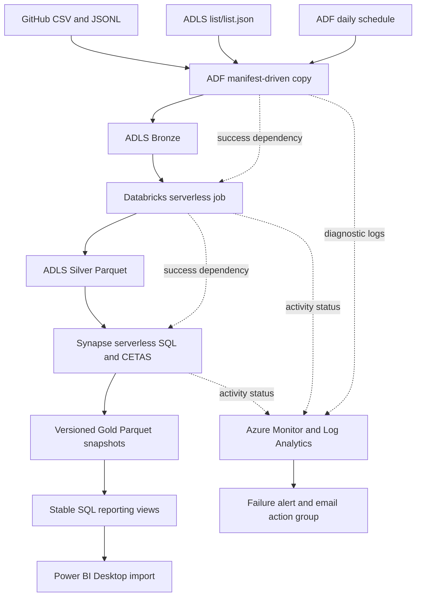

# Paktech Instruments: Azure Data Engineering Pipeline

An end-to-end Azure data engineering portfolio reconstruction using **synthetic data** inspired by the operating domains of Paktech Instruments. No confidential company records are included. The reconstruction demonstrates ingestion, PySpark cleaning, SQL dimensional modelling, reporting, and practical pipeline operations.

The project ingests **21 original source datasets plus a five-customer onboarding file**, prepares Silver Parquet datasets, and materialises **7 dimensions and 12 facts** in Gold. The supplied Power BI model contains **65 customers and 215 sales lines**, with net order value of **PKR 1,587,666,826** at the reviewed refresh.

## Architecture

Power BI refresh is **manual after successful Gold publication**. The ADF export uses DelimitedText Copy; Bronze is therefore a source landing layer, not a claim of byte-for-byte source preservation.

## What is implemented

- Parameterised ingestion using a manifest, Lookup, ForEach, and HTTP-to-ADLS Copy.
- A single Databricks notebook handling dates, currency text, nulls, known duplicate extracts, nested attendance arrays and reference-confirmed synthetic corrections.
- SQL facts at sales-line and purchase-line grains; separate operational facts and shared dimensions.
- Versioned CETAS outputs with reporting views updated after all 19 builds pass selected checks.
- Projection-only SQL validation plus build-time line-key/date checks; four published relationship checks.
- Azure Monitor diagnostic logs, KQL investigation, a metric-based pipeline failure alert and email action group configured and exercised during the project.
- Gold-only recovery, an intentional missing-file failure followed by correction, new-file onboarding, sales-view rollback/restoration, and manual cleanup of a failed Gold run.
- A daily schedule configured and reported successfully tested. The exported schedule is 09:00 Pakistan time; change or stop it when not needed.

## Repository guide

| Path | Contents |
|---|---|
| [`raw_csv/`](raw_csv/) / [`raw_json/`](raw_json/) | Existing synthetic sources; paths retained for ingestion |
| [`config/list.json`](config/list.json) | Current 22-entry ingestion manifest |
| [`databricks/`](databricks/) | Notebook and Databricks source export; business code preserved |
| [`adf/`](adf/) | As-exported ARM assets plus individually readable definitions |
| [`sql/`](sql/) | External access, source views, initial-install helper, runtime, checks and inventory |
| [`monitoring/`](monitoring/) | KQL queries |
| [`powerbi/`](powerbi/) | PBIX, extracted DAX, Power Query, relationships and row counts |
| [`docs/setup.md`](docs/setup.md) | Environment prerequisites and execution order |
| [`docs/data_model.md`](docs/data_model.md) | Model grains and actual Power BI relationships |
| [`docs/operations.md`](docs/operations.md) | Monitoring, onboarding, retries, recovery and retention |
| [`docs/tested_scenarios.md`](docs/tested_scenarios.md) | Completed exercises and measured checks |
| [`docs/export_review.md`](docs/export_review.md) | Export observations and deployment gaps |

## Running the project

1. Provision the Azure services and ADLS-backed Databricks volumes described in [setup](docs/setup.md).
2. Review ARM parameters and environment-specific Databricks settings; supply the ADLS account key privately. The ADF export does not provision the whole platform.
3. Upload `config/list.json` to the **`list` container as `list.json`**, which is the Lookup dataset's actual source. A GitHub manifest edit alone does not update that ADLS copy.
4. Run ingestion and the Silver notebook before querying the Silver source views.
5. Run `sql/01_external_access.sql` and `sql/02_silver_source_views.sql` with administrator access. On an empty reporting schema only, use the new, statically checked `sql/03_bootstrap_reporting.sql` helper to create initial reporting objects; it was not executed in the original workspace.
6. For normal refresh use the deployed `Main_Pipeline`. It invokes the Databricks job and the exported Gold runtime. `sql/04_build_gold.sql` supports `@validate_only = 1` for projection checks and `0` for building/publication.
7. Refresh Power BI Desktop manually after completion.

The exported pipelines have **no explicit concurrency property**. Set **Concurrency = 1** on `Main_Pipeline` and `Recover_Gold` before unattended use, and do not run them together. See the export review for other configuration observations. This repository documents that gap rather than claiming the supplied export already enforces the limit.

## Business analysis

The four report pages cover sales/customer contribution, invoice collection and aging, procurement/delivery performance, and service/training activity. Measures include net order value, month-over-month change, units, average order value, outstanding balance, overdue quantity, resolution time and training feedback. Definitions are in [`powerbi/measures.dax`](powerbi/measures.dax).

## Design choices and boundaries

This is a **full-load** implementation. Silver is overwritten, while Gold uses new output locations because CETAS cannot overwrite previous output files. Power BI queries stable SQL view names instead of discovering the latest folder.

Gold build failure leaves the existing reporting views untouched. Publication of 19 views is sequential, **not atomic**; partial-publication recovery is a documented operating concern. Prior outputs are retained until deliberately reviewed and removed.

Other boundaries: small synthetic datasets; notebook source-ID rules and record-specific corrections; inferred schemas; some financial fields remain floats; remaining Power Query date parsing/deduplication; no incremental merge, automated retention, automated Power BI Service refresh, global execution lock, infrastructure-wide deployment automation, or captured Log Analytics/alert ARM resources. The initial-install helper is a handover addition requiring first-deployment verification.

## Evidence and reproducibility

The attached artifacts are preserved exports, not a fresh execution in another Azure subscription. Local checks validated JSON, Python syntax, manifest paths, notebook code preservation and PBIX model contents. Cloud exercises were completed in the project workspace and reported in the build session.
